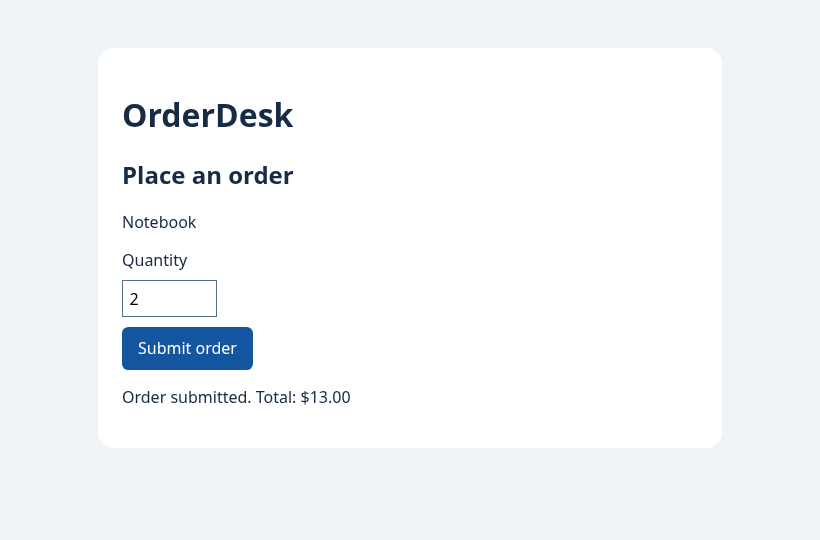

# Yousif Ahmed Al-Dhafari
### Software Quality Assurance Engineer


I design risk-based test coverage for web, mobile and API products. My work spans exploratory testing, regression automation, defect triage, CI feedback and release recommendations. This portfolio contains original test assets for fictional and public demo targets.

## Featured work

| Project | What to review |
| --- | --- |
| [OrderDesk QA case study](07-Sample-Projects/orderdesk/README.md) | A repeatable fictional order workflow with requirements, synthetic test data, boundary tests, automation and defect evidence. |
| [Public API contracts](03-API-Testing/README.md) | A Postman suite for simulated CRUD and bearer authentication with schema and timing assertions. |
| [Catalog performance testing](04-Performance-Testing/README.md) | Five k6 workloads with workload rationale, pass criteria and a report template. |
| [AI-output evaluation](07-Sample-Projects/ai-evaluation/README.md) | A deterministic rubric that checks schema, allowed actions and repetition of a synthetic restricted marker. |



## About my QA work

- Built and maintained **120+ automated regression scenarios** using Cypress, Playwright and Selenium.
- Designed and executed **250+ manual and automated test cases** across web and mobile products.
- Created **70+ detailed Jira defect reports** with reproduction steps and supporting evidence.
- Reduced repetitive regression testing effort by **35%**.
- Expanded test coverage across high-risk user journeys by **30%**.

These are professional achievements documented in my QA résumé. Results for the independent projects here are recorded in the [verification report](06-Test-Reports/README.md).

## Skills and repository navigation

| Area | Skills and tools | Portfolio material |
| --- | --- | --- |
| Manual QA | Risk assessment, functional, exploratory, smoke, sanity, UI/UX, boundary analysis, equivalence partitioning, Jira and Redmine | [Plan](01-Manual-Testing/Test-Plan/README.md) · [Cases](01-Manual-Testing/Test-Cases/README.md) · [Traceability](01-Manual-Testing/Test-Scenarios/README.md) · [Defects](01-Manual-Testing/Bug-Reports/README.md) · [Execution](01-Manual-Testing/Test-Execution/README.md) |
| Web automation | TypeScript, JavaScript, Python, page objects, isolated fixtures, network intercepts | [Playwright](02-Automation-Testing/Playwright/README.md) · [Cypress](02-Automation-Testing/Cypress/README.md) · [Selenium](02-Automation-Testing/Selenium/README.md) |
| Mobile QA | Appium, UiAutomator2 and Android emulator setup | [Android smoke check](02-Automation-Testing/Appium/README.md) |
| API and performance | REST contracts, Postman, Newman, schema validation, k6 test profiles and thresholds | [API testing](03-API-Testing/README.md) · [Performance testing](04-Performance-Testing/README.md) |
| Delivery | Git, GitHub Actions, trace and JUnit evidence, release criteria | [CI workflow](05-CI-CD/README.md) · [QA process](docs/QA-Process.md) · [SDLC/STLC](docs/SDLC-STLC.md) · [Strategy](docs/Testing-Strategy.md) |

## Run the fastest checks

From the repository root with Node.js 24 and Python 3.12:

```sh
node --test scripts/contract-test.mjs
python3 07-Sample-Projects/ai-evaluation/evaluate.py
```

Each automation project includes dependency and run instructions. See the [verification report](06-Test-Reports/README.md) for recorded outcomes and environment limitations.

## Contact

**Yousif Ahmed Al-Dhafari** · Software Quality Assurance Engineer
[GitHub profile](https://github.com/Yousif-Ahmed-Aldhafari)
